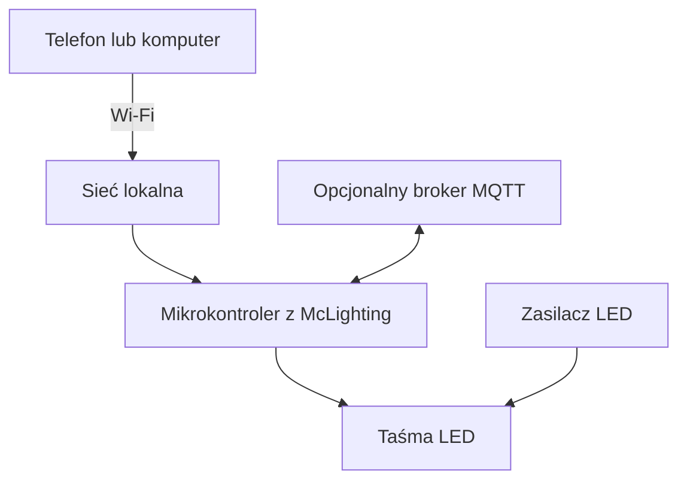

# LampkiNaBalkon

Sterowanie oświetleniem LED na balkonie z wykorzystaniem projektu **McLighting** i wymaganych bibliotek.

## Opis projektu

`LampkiNaBalkon` to projekt oświetlenia balkonu oparty na McLighting — rozwiązaniu umożliwiającym sterowanie adresowalnymi diodami LED za pomocą mikrokontrolera z obsługą Wi-Fi.

Celem projektu jest stworzenie wygodnego systemu oświetlenia, który pozwala zarządzać kolorami i efektami świetlnymi bezpośrednio z poziomu sieci lokalnej.

### Możliwości

- Sterowanie oświetleniem LED przez Wi-Fi.
- Obsługa kolorów RGB i efektów animacji — zgodnie z konfiguracją firmware.
- Zarządzanie oświetleniem przez interfejs WWW.
- Możliwość rozbudowy o integrację MQTT i systemy automatyki domowej, jeśli zostały włączone w konfiguracji.
- Dostosowanie parametrów sterownika do zastosowanej instalacji LED.

## Architektura



## Wymagane komponenty

- Mikrokontroler kompatybilny z używaną wersją McLighting.
- Adresowalna taśma LED RGB, zgodna z konfiguracją projektu.
- Zasilacz dopasowany do napięcia i maksymalnego poboru prądu taśmy.
- Przewody i odpowiednie połączenia elektryczne.
- Komputer z Arduino IDE do przygotowania i wgrania firmware.
- Sieć Wi-Fi zapewniająca komunikację ze sterownikiem.

## Oprogramowanie

- Arduino IDE.
- Firmware McLighting oraz wymagane biblioteki.
- Sterowniki i pakiety dla wybranej płytki mikrokontrolera.
- Opcjonalnie broker MQTT i system automatyki domowej.

Biblioteki należy dobrać do wersji McLighting znajdującej się w repozytorium. W przypadku korzystania z forka lub zmodyfikowanej wersji mogą być wymagane inne wersje zależności.

## Instalacja i konfiguracja

### 1. Pobranie repozytorium

```bash
git clone https://github.com/prometheus-00/LampkiNaBalkon.git
cd LampkiNaBalkon
```

### 2. Przygotowanie środowiska

1. Zainstaluj Arduino IDE.
2. Skonfiguruj obsługę płytki mikrokontrolera.
3. Otwórz projekt w Arduino IDE.
4. Zainstaluj biblioteki wymagane przez dołączony kod.
5. Sprawdź konfigurację sieci Wi-Fi oraz parametry taśmy LED.

### 3. Konfiguracja sprzętu

Przed wgraniem programu sprawdź w plikach źródłowych:

- pin sygnałowy sterujący taśmą LED;
- liczbę diod LED;
- typ obsługiwanej taśmy;
- parametry połączenia Wi-Fi;
- opcjonalną konfigurację MQTT.

**Uwaga:** wartości pinów, liczby diod i ustawień sieciowych muszą odpowiadać faktycznie użytemu sprzętowi i wersji oprogramowania.

### 4. Wgranie firmware

1. Podłącz mikrokontroler do komputera przez USB.
2. Wybierz właściwą płytkę oraz port komunikacyjny w Arduino IDE.
3. Skompiluj projekt.
4. Wgraj firmware do mikrokontrolera.
5. Otwórz monitor portu szeregowego, jeśli jest potrzebny do diagnostyki.

### 5. Uruchomienie

Po uruchomieniu sterownika połącz się z siecią skonfigurowaną dla projektu i ustal adres IP urządzenia. Następnie otwórz interfejs WWW pod adresem sterownika.

Dokładny sposób pierwszej konfiguracji zależy od wersji McLighting oraz ustawień Wi-Fi zapisanych w projekcie.

## Integracja z automatyką domową

Jeśli firmware ma włączoną obsługę MQTT, sterownik można wykorzystać w systemie automatyki domowej, na przykład Home Assistant.

Wymaga to odpowiedniej konfiguracji:

- brokera MQTT;
- danych połączenia i uwierzytelniania;
- tematów MQTT;
- integracji obsługiwanej przez daną wersję firmware.

Integracja MQTT jest opcjonalna i zależy od konfiguracji kompilacji.

## Bezpieczeństwo instalacji

- Dobierz zasilacz do napięcia znamionowego taśmy LED.
- Uwzględnij maksymalny pobór prądu wszystkich diod.
- Nie zasilaj długiej taśmy LED bezpośrednio z pinu mikrokontrolera.
- Zapewnij odpowiedni przekrój przewodów i stabilne połączenia.
- Zabezpiecz elektronikę przed wilgocią, deszczem i kondensacją pary wodnej.
- Nie umieszczaj niezabezpieczonych połączeń elektrycznych na zewnątrz.

## Rozwiązywanie problemów

| Problem | Co sprawdzić |
|---|---|
| Sterownik nie łączy się z Wi-Fi | Dane sieciowe, zasięg i konfigurację firmware |
| Interfejs WWW jest niedostępny | Adres IP, połączenie sieciowe i logi urządzenia |
| Diody nie świecą | Zasilanie, polaryzację, przewód DATA i konfigurację pinu |
| Nie wszystkie diody działają | Liczbę diod, połączenia i wydajność zasilania |
| Nie działają efekty | Wersje bibliotek i konfigurację firmware |
| MQTT nie działa | Adres brokera, port, uwierzytelnianie i tematy |

## Struktura repozytorium

Aktualną strukturę plików można sprawdzić poleceniem:

```bash
find . -maxdepth 3 -type f
```

Poszczególne katalogi i pliki należy opisać zgodnie z ich faktyczną zawartością w repozytorium.

## Licencja

Przed określeniem licencji projektu należy sprawdzić plik `LICENSE` oraz warunki licencyjne wykorzystanego kodu McLighting i dołączonych bibliotek.

## Autor i źródła

- **Autor projektu:** [prometheus-00](https://github.com/prometheus-00)
- **Repozytorium:** [LampkiNaBalkon](https://github.com/prometheus-00/LampkiNaBalkon)
- **Projekt bazowy:** [McLighting](https://github.com/toblum/McLighting)

---

Projekt przeznaczony do eksperymentowania z oświetleniem LED i automatyką domową.
